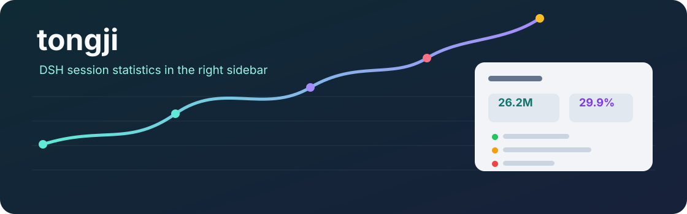

<div align="center">
  
  <h1>tongji</h1>
  <p><strong>Session observability for DSH: usage, context, fleet and insights</strong></p>
  <p>A local Desktop plugin that reads DSH statistics snapshots, session projections and session logs to show token usage, context composition, tool and command activity, sub-agent fleets and cross-session overviews. It shows no account balance and no cost.</p>
  <p><a href="README.md">简体中文</a> · <strong>English</strong></p>
  <p>Desktop plugin · v0.1.41 · Apache-2.0</p>
  <p><a href="#surfaces">Surfaces</a> · <a href="#data-and-refresh">Data and refresh</a> · <a href="#installation">Installation</a> · <a href="#configuration">Configuration</a> · <a href="#build-and-verification">Build and verification</a> · <a href="#limitations">Limitations</a> · <a href="#license">License</a></p>
</div>

---

`tongji` puts session observability inside the DSH interface. It only reads local session data: it makes no model calls and runs no tools on your behalf, and the built-in Statistics view keeps working as before.

## Surfaces

| Surface | Where | What it shows |
| --- | --- | --- |
| Statistics | Section of the Session panel beside the Chat transcript (hide it with the session-panel toggle in the header) | Session totals, per-turn usage, cache hit rate, context composition, agent network, background jobs, SSH connections |
| Statistics panel | Conversation view tab (can be hidden) | The same, plus context timeline, request detail, tool definitions, file activity, command log, context events |
| Fleet | Conversation view tab (can be hidden) | Sub-agent tree, agent network, tasks and exchanged messages |
| Context insights | Main page plus a sidebar panel entry (can be hidden) | Cross-session overview, trends, skill catalog, recommendations |
| Context jump | Assistant message actions | Jump from a turn to its place in the context view |
| Context modal | Composer overlay | Quick context glance while writing |
| Settings card | Plugin page, "Configuration" | Placement, view defaults, system-prompt prefix and suffix |

## Languages

The interface is **Chinese only**: one dictionary (763 entries), no second copy to maintain. The DSH language service always ends its fallback chain at `en` (`FALLBACK_LOCALE`), so the `en` slot points at that same Chinese dictionary — switching DSH to an English interface still renders Chinese and never leaks raw keys such as `turnusage.title`. The plugin-list card keeps `locale/zh.json` and `locale/en.json` (122 bytes each); those are DSH plugin-manifest metadata, not panel chrome.

## Features

### Usage

- Session totals, per-turn summary and per-step detail; turns stay collapsed until expanded.
- Uncached input, cached input with hit rate, cumulative input (including cache writes), cumulative output, cumulative total tokens, and main-agent output speed.
- Child-agent usage is assigned to the main-session turn that created it, including retries and descendants; inherited child history is never double counted. Usage without an identifiable creation turn is listed separately, and external agents or missing usage are marked unknown.
- Tokens and turns only: the panel shows no balance, spend or price, and it never fetches a price catalog.

### Context

- Timeline: grouped by step or turn, switchable between cumulative and delta, with an optional duration curve, a fit-to-width overview mode, and a DNA mode that colours every request by what entered the window.
- Request detail: what each model request carried (system prompt, tool schemas, user messages, injected content, skill injections, assistant output).
- Measurement: occupancy, composition shares and image tokens are estimates — text at a fixed 4 characters per token, images on a 14px patch grid (the Qwen2-VL formula; DeepSeek does not publish its image billing formula). The composition card drops the estimate label only when both provider-reported occupancy and an official breakdown are present.
- Context events: injection, compaction, pruning, model switch, mode switch.
- Tool definitions and file activity: schema sizes; file read, write, search and image operations with hit counts and line deltas.
- Command log: filter by failed, slow or background, with exit codes, stderr, truncation flags, sandbox denials and timeouts, plus a jump back to the result message.
- Background jobs (under the token and timing cards): running or detached jobs with the command excerpt, state, duration, exit detail and job id; running jobs stay on top and their duration ticks by the second. Data comes from the `job/registered` and `job/settled` events in the session log; foreground jobs that finished stay in the command log only.
- Attachment previews and history paging: older history loads on request through the official session query interface, never eagerly when the panel opens.

### Fleet and insights

- Fleet: sub-agent hierarchy, roles and task badges, an agent network graph, and the messages exchanged between agents.
- Insights: cross-session overview (today, 7 days, 30 days), daily heat and trends, skill catalog and recommendations.

### System prompt

The prefix and suffix from the settings card are spliced at the very start and end of every session system prompt, for every agent including sub-agents. Both are empty by default, and a change applies from the next turn. This is the highest-privilege feature in the plugin and is not a statistics feature.

## Data and refresh

- Data comes from DSH statistics snapshots, `sessionProjections` projections and session logs. The Host keeps a per-session incremental fold cache and evicts it in least-recently-used order. Sessions past 30,000 events fold on a **single** background worker (one at a time; a busy worker falls back to the Host thread).
- The on-disk overview cache merges only the sessions this run refreshed instead of overwriting itself, and keeps the 4000 most recently updated entries under 24 MB.
- While the pane is open, the per-turn usage card polls every five seconds and the overview refreshes on its own cadence; closing the pane stops the polling.
- Three network calls exist, all degradable: the update check against this repository's GitHub releases (a failure affects only the version hint), the recommendation feed from `raw.githubusercontent.com` (falls back to the `gh-proxy.org` mirror), and recommendation icons from `cdn.simpleicons.org`.
- The Host exposes fourteen routes under `/api/tongji/`: `version`, `skills`, `recom`, `fleet`, `attachment`, `detail`, `delta`, `facts`, `heads`, `commands`, `snapshot`, `overview`, `backfill`, `usage`.

## Installation

### 1. Requirements

DSH Desktop, a local plugin directory and an editable Desktop profile are required. The code declares a `0.2.0-rc.2` baseline: older DSH releases fall back to reduced projections and some panels do not appear.

### 2. Install the plugin files

```sh
git clone https://github.com/yueyexiayu/dsh-tongji.git ~/.dsh/plugins/tongji
```

If that directory already exists, do not overwrite its contents; back it up or choose another directory first.

### 3. Register it in the Desktop profile

Add this entry to `dependencies` in `~/.dsh/profiles/desktop/package.json`:

```json
"tongji": "link:/Users/YOUR_USERNAME/.dsh/plugins/tongji"
```

Add `"tongji"` to the `dsh.profile.bundles` array as well, then install from the profile directory:

```sh
cd ~/.dsh/profiles/desktop
pnpm install
```

Quit DSH completely (⌘Q) and reopen it. "统计" is a section of the Session panel beside the Chat transcript (toggle it from the header); the right sidebar is no longer used, and the "统计面板" view tab holds the wide layout when you need it.

## Configuration

The plugin ID, package name and bundle name are all `tongji`; install it at `~/.dsh/plugins/tongji` and point the profile link there. Settings live in the plugin page configuration card and can also be overridden in the profile cordis config:

| Key | Values | Effect |
| --- | --- | --- |
| `defaultPlacement` | `show` / `hide` | Whether the statistics panel tab is shown (legacy `all` / `tab` / `sidebar` still parse as `show`) |
| `defaultGranularity` | `step` / `turn` | Timeline grouping |
| `defaultTrendMode` | `total` / `delta` | Cumulative or delta trend |
| `defaultDeltaBase` | `step` / `turn` | Delta baseline |
| `defaultToolSort` / `defaultFileSort` | see the panel | Sorting for tool definitions and file activity |
| `insightsEntry` | `show` / `hide` | Context insights entry |
| `defaultDurationCurve` | `show` / `hide` | Duration curve on the trend chart |
| `overviewAutoSteps` | `100` / `200` / `300` / `off` | Auto-overview step count |
| `defaultOverviewRange` | `today` / `7d` / `30d` | Default insights range |
| `fleetTab` | `show` / `hide` | Fleet tab |
| `statsSection` | `show` / `hide` | The "统计" section inside the Session panel beside Chat |
| `promptPrefix` / `promptSuffix` | text | Injected at the head and tail of the system prompt; empty by default |

Eight further bounds (`maxRequestSteps`, `maxKeptTurns`, `maxEvents`, `maxNodes`, `maxArchiveNodes`, `maxFileOps`, `maxCommands`, `maxCommandChars`) cap how much a single fold keeps.

## Build and verification

```sh
npm run build   # tsdown: src/ -> lib/ (ESM host, browser CJS wrapper for the client)
npm run verify  # node --check on all three artifacts, tsc --noEmit, and the whole test suite
```

The artifacts stay self-contained: `lib/index.js` imports only `node:` builtins and `./usage.js`, and `lib/client.js` has no external `require`, so no `node_modules` is needed at runtime.

On `v0.1.30`, `npm run build` and `npm run verify` both pass (`verify` = artifact syntax checks, `tsc --noEmit`, then the suite) with 45 tests green: three version-probe cases, four cache-merge and bound cases, two lifecycle-boundary cases, three inherited-prefix cases (`seedCut`), three subagent-failure cases, eight job-fold cases (registration, settlement, background marking, detachment, `zsh` and buffered commands), and the 22 existing cases; the ten pricing and cost cases were removed with the feature.

## Limitations

- The real UI was only load-verified on DSH `0.2.3-alpha.2` (the plugin writes under `~/.dsh/storages/tongji/`); the earlier live record covers the v0.1.13 panel and not the context view, agent network or command panel.
- Build-time dependencies are pinned to `0.2.2-rc.5`, which can differ from the running DSH; a DSH upgrade needs a rebuild against the new modules.
- With no current session on the home screen, the panel shows no session statistics.
- The fold cache filters by existing sessions but has no byte cap; it is currently about 5 MB on this machine.
- Error codes are `tongji/*` since `v0.1.17`; the legacy `dsh-context/*` prefix is still normalized.
- The recommendation slot reads `data/recoms.json` from this repository and falls back to a built-in entry, marked degraded, when that file is absent.
- The version guard reads the installation first (`app.asar/dsh/package.json`, then the macOS bundle `Info.plist`) and the module tree after that; when every probe fails it logs one warning and treats the version as unknown, and `/api/tongji/version` reports `harness: null`.
- The panel's workspace root comes from DSH's `workingDirectory` projection, which follows a directory change; DSH's own session list still uses the root in the session header, so the two can differ after a `cd`.
- The background-job card covers only jobs whose DSH job event can be tied to a command (`bash`, `zsh`, `pwsh` or a command inside `run_code`); the command log's background count also includes `run_code` records whose result text carried a background acknowledgement, so the two counts can disagree.
- The background-job card was not re-rendered in the real UI for this change (plugin code loads only after DSH restarts); its data layer was verified by folding a real session log.

## License

This repository is released under the Apache License 2.0; see [LICENSE](LICENSE).

`src/ui/` is derived from [bowenliang123/dsh-context](https://github.com/bowenliang123/dsh-context) v0.84.1 (Apache-2.0, copyright the original author). Its license text is kept at [`src/ui/LICENSE`](src/ui/LICENSE), and the change record plus provenance are in [`src/ui/NOTICE.md`](src/ui/NOTICE.md). `src/host/` is tongji's own code.

## Community

Use GitHub Issues for questions and suggestions: https://github.com/yueyexiayu/dsh-tongji/issues

<div align="center"><sub>An observability panel for DSH sessions · <a href="README.md">阅读中文版 →</a></sub></div>
