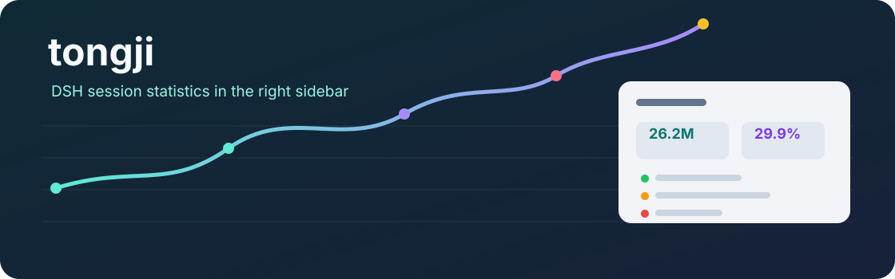
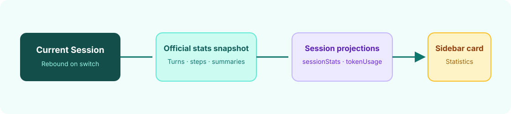

<div align="center">
  
  <h1>tongji</h1>
  <p><strong>Session statistics in the DSH conversation sidebar</strong></p>
  <p>A local Desktop UI plugin that reads DSH statistics snapshots and session projections to show totals, per-turn metrics, and step summaries.</p>
  <p><a href="README.md">简体中文</a> · <strong>English</strong></p>
  <p>Desktop plugin · v0.1.8</p>
  <p><a href="#features">Features</a> · <a href="#how-it-works">How it works</a> · <a href="#installation">Installation</a> · <a href="#configuration">Configuration</a> · <a href="#validation-and-limitations">Validation and limitations</a></p>
</div>

---

`tongji` places a session statistics summary in the DSH right sidebar. It reads the session statistics snapshot and reported usage from session logs. It makes no additional model or tool calls, and the built-in Statistics view remains unchanged.

## Features

| Session totals | Per-turn summary | Step status |
| --- | --- | --- |
| Cumulative context, cache hit, output, and main-agent output speed | Cumulative context and output, including available child usage; turns are collapsed by default | Expand a turn to see main-agent step summaries |

Totals and turns both accumulate reported context and output, including retries and available child-agent usage. A child's later work and descendants are assigned to the main-session turn that created it; usage without an identifiable creation turn is listed separately. Inherited child history is excluded to prevent double counting. External agents and missing usage are unknown: `+` marks an incomplete known amount, including context missing cache-read data, and `—` means no available amount. Cache hit uses only samples reporting cache reads and marks incomplete coverage; speed and step details cover the main agent only. Official conversation or per-turn figures can have a different scope and should not be treated as session totals including children. Context and output use `K` / `M` abbreviations; `M` starts at 1,000,000 tokens.

## How it works



The plugin reads the current session's statistics snapshot and uses the Host `sessionQuery` to calculate usage from the session and child logs. It renders the result in its own right-sidebar tab. The original Statistics view remains available in its existing location.

While the pane is open, it refreshes about every 5 seconds during a main-session turn and every 30 seconds while idle, reducing repeated reads of long histories; background child updates can therefore be delayed. Read errors are shown with a retry button, and any last successful result is explicitly marked as stale.

## Installation

### 1. Requirements

DSH Desktop, a local plugin directory, and an editable Desktop profile are required. This repository does not declare a minimum DSH version; the plugin API may vary across DSH releases.

### 2. Install the plugin files

Clone the repository into the local plugin directory:

```sh
git clone https://github.com/yueyexiayu/dsh-tongji.git ~/.dsh/plugins/tongji
```

If that directory already exists, do not overwrite its contents; back it up or choose another directory first.

### 3. Register it in the Desktop profile

Add this entry to `dependencies` in `~/.dsh/profiles/desktop/package.json`:

```json
"tongji": "link:/Users/YOUR_USERNAME/.dsh/plugins/tongji"
```

Add `"tongji"` to the `dsh.profile.bundles` array as well. Replace the sample username with the actual local path, then run in the Desktop profile directory:

```sh
cd ~/.dsh/profiles/desktop
pnpm install
```

Quit DSH completely and reopen it. On entering a conversation, “统计” opens automatically when the sidebar only contains its default guide. If a browser or another page is already open, that page keeps focus and “统计” remains available from the sidebar. If the sidebar is closed, reopen it through DSH's existing controls.

## Configuration

The package, plugin ID, and bundle name are `tongji`. The visible tab title is “统计”. Install it at `~/.dsh/plugins/tongji` and point the profile dependency link to that directory.

The plugin has no additional settings. Turns are collapsed by default. The turn area has its own scrollbar and pages earlier history through the official `Session.loadOlder()` method until the complete history is available. The card is only shown when a current Session is available.

## Validation and limitations

The plugin was verified in DSH Desktop `0.2.2-alpha.2-4dd5ab8`: plugin loading, Session switching, comparison of totals with the official Statistics view, turn collapse/expand, and status colors. Plugin JavaScript passed Node syntax checks. This verification does not guarantee compatibility with every DSH version.

- The plugin uses DSH client services and statistics snapshots; future API changes may require updates.
- The card is not shown on the home screen when there is no current Session.
- This repository has no license file. Do not assume an open-source license until the maintainers choose one.
- The public repository excludes the Desktop profile, user sessions, databases, and dependency directories.

## Community and license

Use GitHub Issues for questions and suggestions. No license is declared in this repository; until one is added, permission to use and redistribute the code is not granted.

<div align="center"><sub>A lightweight statistics entry point for DSH sessions · <a href="README.md">阅读中文版 →</a></sub></div>
