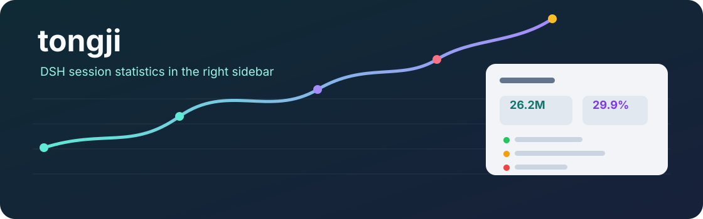

<div align="center">
  
  <h1>tongji</h1>
  <p><strong>DSH 会话可观测性面板：用量、成本、上下文、编队与洞察</strong></p>
  <p>本地 Desktop 插件。读取 DSH 会话统计快照、会话投影与会话日志，展示 token 用量与成本、上下文构成、工具与命令活动、子代理编队和跨会话总览。</p>
  <p><strong>简体中文</strong> · <a href="README.en.md">English</a></p>
  <p>Desktop 插件 · v0.1.17 · Apache-2.0</p>
  <p><a href="#功能面">功能面</a> · <a href="#数据来源与刷新">数据来源与刷新</a> · <a href="#安装">安装</a> · <a href="#配置">配置</a> · <a href="#构建与验证">构建与验证</a> · <a href="#限制">限制</a> · <a href="#许可">许可</a></p>
</div>

---

`tongji` 把会话的可观测性数据放进 DSH 界面。它只读本地会话数据，不发起模型调用，也不代替你执行工具；官方「统计」视图保持原样。

## 入口

| 入口 | 位置 | 内容 |
| --- | --- | --- |
| 统计 | 会话右侧栏标签页（默认引导页时自动打开） | 会话总计、每轮用量、成本、平台余额 |
| 上下文 | 对话视图标签页 | 上下文时间线、请求详情、工具定义、文件活动、命令执行、上下文事件 |
| 编队 | 对话视图标签页（可关闭） | 子代理树、Agent 网络图、任务与往来消息 |
| 上下文洞察 | 主页面 + 侧栏面板入口（可关闭） | 跨会话总览、趋势、技能目录、推荐位 |
| 上下文跳转 | 助手消息动作区 | 从某一轮跳到上下文视图中对应的位置 |
| 上下文弹窗 | 输入框浮层 | 输入时的上下文速览 |
| 插件设置卡 | 插件页「配置」 | 入口位置、视图默认值、系统提示词前后缀 |

## 语言

界面**只有中文**，词典只有一份（774 条），没有第二份文案需要维护。DSH 语言服务的回退链固定以 `en` 收尾（`FALLBACK_LOCALE`），所以 `en` 位置指向同一份中文词典：即使把 DSH 切成英文界面，面板显示的仍是中文，不会露出 `turnusage.title` 这类键名。插件列表卡片保留 `locale/zh.json` 与 `locale/en.json`（各 132 字节），那是 DSH 插件清单的元数据，不是面板界面。

## 功能面

### 用量与成本

- 会话总计、每轮摘要、每步明细；轮次默认折叠，展开后才挂载步骤表。
- 未命中输入、缓存命中输入（附命中率）、累计输入（含缓存写入）、累计输出、累计总 token、主代理输出速度。
- 子代理用量归入创建它的主会话轮次（含其后代与重试），继承的历史不重复计入；无法定位创建轮次的用量单列为「未归属」，外部子代理或缺失用量标为未知。
- 成本按 models.dev 价格目录计算：目录 1 小时 TTL、8 秒超时、失败 30 秒退避；DeepSeek 供应商的峰时时段按 2 倍计价；美元与人民币按固定汇率 0.15 换算。
- 每个模型都给出价格来源与置信度（直接命中、分支后缀、归一化、供应商别名、厂牌分支、规范名、家族、索引），以及缺失原因（目录不可用、模型未知、歧义、无条目）。

### 上下文

- 时间线：按步骤或轮次聚合，可切总量/增量、叠加耗时曲线、铺满一屏的总览模式，以及按请求逐条着色的 DNA 指纹模式。
- 请求详情：每次模型请求的上下文构成（系统提示词、工具定义、用户消息、注入内容、技能注入、助手输出）。
- 上下文事件：注入、压缩、剪枝、模型切换、模式切换。
- 工具定义与文件活动：工具 schema 的规模；文件读取/写入/搜索/图片操作、命中行数与行数变化。
- 命令执行：按失败/慢/后台筛选，展示退出码、stderr、截断标记、沙箱拒绝与超时，并可回跳到结果消息。
- 附件预览与历史分页：更早历史通过官方 `Session.loadOlder()` 按需加载，打开面板不会拉全量历史。

### 编队与洞察

- 编队：子代理树的层级、角色、任务徽章，Agent 网络图与往来消息事件。
- 洞察：跨会话总览（今日 / 7 天 / 30 天）、按日热力与趋势、技能目录、推荐位、平台余额。

### 系统提示词

设置卡里的前缀/后缀会拼到所有会话系统提示词的最前/最后，对所有代理（含子代理）生效，默认留空；修改从下一轮对话开始应用。这是本插件权限最高的一处，不是统计功能。

## 数据来源与刷新

- 数据来自 DSH 的会话统计快照、`sessionProjections` 投影与会话日志；Host 侧按会话保留增量折叠缓存，用 worker 线程池折叠步骤，缓存按最近使用顺序有界淘汰。
- 面板打开时，每轮用量卡按 5 秒轮询；总览按其自身节奏刷新。面板关闭即停止轮询。
- 网络访问只有两处：价格目录 `models.dev/api.json`，以及版本检查（本仓库的 GitHub Releases）。两者失败都只影响对应区块，不影响其余面板。
- Host 路由共 15 条，前缀 `/api/tongji/`：`version`、`balance`、`skills`、`recom`、`fleet`、`attachment`、`detail`、`delta`、`facts`、`heads`、`commands`、`snapshot`、`overview`、`backfill`、`usage`。

## 安装

### 1. 前置条件

需要 DSH Desktop、本地插件目录和可编辑的 Desktop profile。代码内置基线 `0.2.0-rc.2`：低于该版本的 DSH 会降级为回退投影，部分面板不出现。

### 2. 放置插件文件

```sh
git clone https://github.com/yueyexiayu/dsh-tongji.git ~/.dsh/plugins/tongji
```

目录已存在时不要覆盖其中已有文件；先备份或换一个目录。

### 3. 注册到 Desktop profile

在 `~/.dsh/profiles/desktop/package.json` 的 `dependencies` 中加入：

```json
"tongji": "link:/Users/你的用户名/.dsh/plugins/tongji"
```

并把 `"tongji"` 加进 `dsh.profile.bundles`。然后在 profile 目录安装依赖：

```sh
cd ~/.dsh/profiles/desktop
pnpm install
```

完全退出 DSH（⌘Q）再打开。进入会话后，若右侧只有默认引导页会自动打开「统计」；若已有其他页面则保留当前页面，可从侧栏选择「统计」。

## 配置

插件 ID、包名与 bundle 名均为 `tongji`，安装目录为 `~/.dsh/plugins/tongji`，profile 的依赖链接必须指向该目录。设置项写在插件页的配置卡里，也可以在 profile 的 cordis 配置里覆盖：

| 键 | 取值 | 作用 |
| --- | --- | --- |
| `defaultPlacement` | `all` / `tab` / `sidebar` / `hide` | 上下文面板挂在哪 |
| `defaultGranularity` | `step` / `turn` | 趋势图粒度 |
| `defaultTrendMode` | `total` / `delta` | 趋势图看总量还是增量 |
| `defaultDeltaBase` | `step` / `turn` | 增量的对比基线 |
| `defaultToolSort` / `defaultFileSort` | 见面板选项 | 工具定义与文件活动排序 |
| `insightsEntry` | `show` / `hide` | 上下文洞察入口 |
| `defaultDurationCurve` | `show` / `hide` | 趋势图耗时曲线 |
| `overviewAutoSteps` | `100` / `200` / `300` / `off` | 自动总览步数 |
| `defaultOverviewRange` | `today` / `7d` / `30d` | 洞察默认时间范围 |
| `fleetTab` | `show` / `hide` | 编队标签页 |
| `promptPrefix` / `promptSuffix` | 文本 | 注入系统提示词首尾，默认留空 |

另有 8 个上限（`maxRequestSteps`、`maxKeptTurns`、`maxEvents`、`maxNodes`、`maxArchiveNodes`、`maxFileOps`、`maxCommands`、`maxCommandChars`），用来限制单次折叠保留的数据量。

## 构建与验证

```sh
npm run build   # tsdown：src/ -> lib/（host 走 ESM，client 走浏览器 CJS 包装）
npm run verify  # node --check 三个产物 + 全部测试
```

产物自包含：`lib/index.js` 只依赖 `node:` 内置与 `./usage.js`，`lib/client.js` 没有外部 `require`，运行时不需要 `node_modules`。

当前 `v0.1.17` 的实测结果：`npm run build` 与 `npm run verify` 通过，测试 32 例全绿（含 10 例价格与成本定点用例、22 例既有用例）。

## 限制

- 服务端渲染之外的真实 UI 只在 DSH `0.2.3-alpha.2` 上加载验证过（插件会写入 `~/.dsh/storages/tongji/`）；更早的实机记录针对 v0.1.13 的旧面板，未覆盖上下文视图、Agent 网络与命令面板。
- 构建期依赖钉在 `0.2.2-rc.5`，与运行中的 DSH 版本可能不同；升级 DSH 后需要重新对齐并重建。
- 首页没有当前会话时，面板不显示会话统计。
- 折叠缓存按现存会话过滤，但没有按字节数设上限；本机当前约 5 MB。
- 错误码自 `v0.1.17` 起统一为 `tongji/*`，`dsh-context/*` 旧前缀仍会被归一化处理。
- 推荐位读取本仓库 `data/recoms.json`；该文件不存在时回落内置条目并标记为降级。

## 许可

本仓库以 Apache License 2.0 发布，全文见 [LICENSE](LICENSE)。

`src/ui/` 衍生自 [bowenliang123/dsh-context](https://github.com/bowenliang123/dsh-context) v0.84.1（Apache-2.0，版权归原作者），其许可证原文保留在 [`src/ui/LICENSE`](src/ui/LICENSE)，改动记录与来源见 [`src/ui/NOTICE.md`](src/ui/NOTICE.md)。`src/host/` 下是 tongji 自有代码。

## 社区

问题与建议请用 GitHub Issues（https://github.com/yueyexiayu/dsh-tongji/issues）。

<div align="center"><sub>为 DSH 会话提供可观测性面板 · <a href="README.en.md">Read in English →</a></sub></div>
