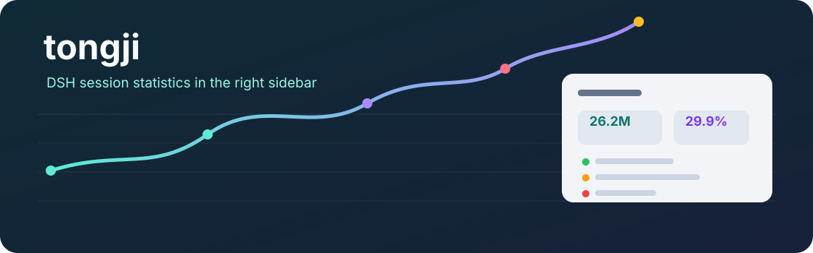
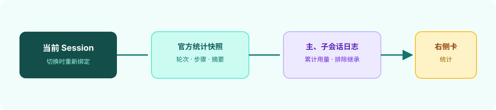

<div align="center">
  
  <h1>tongji</h1>
  <p><strong>在 DSH 对话右侧查看当前会话统计</strong></p>
  <p>本地 Desktop UI 插件，读取 DSH 官方统计视图与会话投影，显示总计、每轮指标和步骤摘要。</p>
  <p><strong>简体中文</strong> · <a href="README.en.md">English</a></p>
  <p>Desktop 插件 · v0.1.12</p>
  <p><a href="#核心能力">核心能力</a> · <a href="#工作方式">工作方式</a> · <a href="#安装">安装</a> · <a href="#配置">配置</a> · <a href="#验证与限制">验证与限制</a></p>
</div>

---

`tongji` 将会话统计摘要放进 DSH 的右侧栏。它读取会话统计快照和会话日志中的用量，不发起额外模型或工具调用。原生“统计”视图保持不变。

## 核心能力

| 会话总计 | 每轮摘要 | 步骤状态 |
| --- | --- | --- |
| 未命中输入、缓存命中输入、带缓存命中率的累计输入、累计输出、累计总 Token 及主代理输出速度 | 输入、输出和总 Token 包含可读取的子代理用量；轮次默认折叠 | 展开轮次查看主代理步骤摘要 |

总计与每轮的输入、输出和总 Token 都是累计值，包含可读取的子代理自身用量和模型重试；子代理（包括其后续轮次和后代）归入创建它的主会话轮次。无法定位创建轮次的用量单独列为未归属。子会话继承的历史不会重复计入。未命中输入来自非缓存输入；缓存命中输入来自缓存读取；累计输入还包含缓存写入；累计总 Token 再包含输出。累计输入后的括号直接显示缓存命中率；缓存命中输入悬浮提示提供精确 token 和命中率。外部子代理或缺失用量标为未知：`+` 表示已知数值不完整，`—` 表示没有可用数值，“部分”表示有未计入的用量。输出速度及步骤明细只反映主代理。官方对话下方或单轮数字可能采用不同范围，不能直接当作含子代理的会话总计。数值在 1,000 token 以下显示精确整数，之后使用 `K` / `M` 缩写；悬停可查看可用的精确值。界面支持中文与英文，其他语言回退到英文。

## 工作方式



插件读取当前会话统计快照，使用 Host 的 `sessionQuery` 读取当前会话和子会话日志计算累计用量，并通过独立右侧栏 Tab 渲染摘要。Host 按会话保留增量折叠缓存，只处理新追加的事件，并以受限并发读取子会话；缓存按最近使用顺序有界淘汰。切换会话时，右侧卡片绑定到新的 Session；官方统计视图仍可从原位置打开。

面板打开时，主会话进行中约每 5 秒刷新一次；空闲时约每 30 秒刷新一次，后台子代理的更新可能因此延迟。读取失败会显示稳定错误码、上次成功更新时间与重试按钮；已有结果会保留并标为上次成功的数据。

## 安装

### 1. 前置条件

需要 DSH Desktop、本地插件目录和可编辑的 Desktop profile。此仓库未声明最低 DSH 版本；插件 API 可能随 DSH 版本变化。

### 2. 安装插件文件

将仓库克隆到本地插件目录：

```sh
git clone https://github.com/yueyexiayu/dsh-tongji.git ~/.dsh/plugins/tongji
```

若该目录已存在，不要覆盖其中已有文件；先备份或选择其他目录。

### 3. 注册到 Desktop profile

在 `~/.dsh/profiles/desktop/package.json` 的 `dependencies` 中加入：

```json
"tongji": "link:/Users/你的用户名/.dsh/plugins/tongji"
```

并在 `dsh.profile.bundles` 数组中加入 `"tongji"`。将示例路径中的用户名替换为本机实际路径，然后在 Desktop profile 目录运行：

```sh
cd ~/.dsh/profiles/desktop
pnpm install
```

完全退出并重新打开 DSH。进入会话后，若右侧只有默认引导页，会自动打开“统计”；若已有浏览器或其他内容，则保留当前页面，可在右侧栏选择“统计”。右侧栏关闭后可按 DSH 原有方式重新打开。

## 配置

插件 ID、包名与 bundle 名均为 `tongji`。右侧显示名称为“统计”。安装目录为 `~/.dsh/plugins/tongji`；profile 依赖链接必须指向该目录。

此插件不提供额外设置项。轮次默认折叠，展开后才挂载步骤明细。轮次区域有独立滚动条；更早历史通过官方 `Session.loadOlder()` 按需加载，不会在打开面板时自动拉取全部历史。卡片只在有当前会话时显示。

## 验证与限制

2026-11-13 在 DSH `0.2.2-rc.1` 的实际 Desktop 会话中验证了 v0.1.12 的六项总计、累计输入缓存命中率、每轮摘要和中文说明；`npm run verify` 的语法检查与 18 个自动化测试通过。该验证记录不代表所有 DSH 版本均兼容。

- 插件使用 DSH 公开的客户端服务与统计快照；未来 API 变化可能需要适配。
- 无当前 Session 的首页不显示会话统计卡。
- 本仓库未附许可证文件；在仓库维护者明确选择前，不能假定它采用开源许可证。
- 公开仓库不包含 Desktop profile、用户会话、数据库或依赖目录。

## 社区与许可

问题与建议请使用 GitHub Issues。当前仓库没有声明许可证；在许可证明确之前，使用和再分发权限应视为未授予。

<div align="center"><sub>为 DSH 会话提供轻量统计入口 · <a href="README.en.md">Read in English →</a></sub></div>
